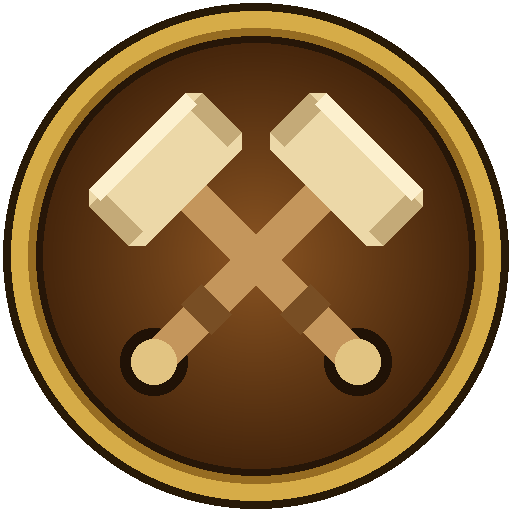

# HAMR

The officers' addon for Clan Battlehammer's HAMR Tools. One addon for both World of Warcraft: Forever and retail.

It copies the raid list and the guild's tick notes out of the game, so officers can paste them into the clan's
site, and writes the site's Call to Arms (CTA) and Help Wanted (HW) totals back into the guild's public notes,
one Save click at a time. It never sends anything anywhere: you copy and paste.

## Install

Download this repository (Code > Download ZIP), unzip it, rename the folder to `HAMR` if needed, and put it in the
game's AddOns folder:

- retail: `World of Warcraft/_retail_/Interface/AddOns/HAMR`
- Forever: the Forever client's `Interface/AddOns/HAMR`

The folder must hold `HAMR.toc` directly. Restart the game.

If the AddOns list says it's out of date after a patch, tick "Load out of date AddOns" until a new version is out.

## Using it

Click the crossed hammers by the minimap (drag them round the edge to move them), or type `/hamr`. On retail
it's also in the minimap's addon menu. The window has three tabs:

- **Raid list**: who's in your raid or party. Copy it (Ctrl+C) and paste it into the event's list on the site.
  Refresh reads the group again.
- **Guild notes**: every guild member whose public note has CTA or HW in it, and the rank names. Paste it under
  "Compare with the game" on the site's Tallies page to see where the notes and the site disagree.
- **Update notes**: paste the totals from the site ("Copy for the addon" on an event, or "Copy all" on Tallies)
  and press Check. Each note that needs changing is shown as before -> after with its own Save button.

Saving is careful:

- Only the numbers after `CTA:` and `HW:` change; the rest of the note stays as the officers wrote it.
- A note that's higher than the site, or isn't a tick note yet (an alt's), is flagged and needs a deliberate click.
- A note someone changed after you pressed Check is never overwritten: the row refreshes instead.
- A row only says Saved once the game's own roster shows the new note. If it doesn't show within a few
  seconds, the row says so and offers Retry; if the game refuses or blocks it, the row says why.
- Nothing is saved in combat.
- Totals from the other game's site are refused.
- Saving needs a guild rank that can edit public notes.

While the window is open, "Show offline members" is on so everyone is listed; closing it puts your setting back.

## Commands

- `/hamr`: open or close the window
- `/hamr raid`, `/hamr roster`, `/hamr notes`: open a tab
- `/hamr minimap`: hide or show the minimap button
- `/hamr help`: list these
