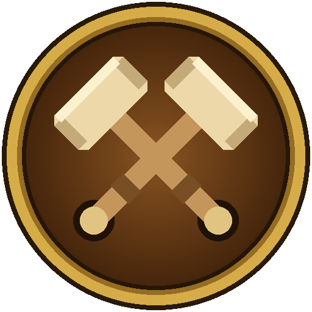

# HAMR

The officers' addon for Clan Battlehammer's HAMR Tools. One addon for both World of Warcraft: Forever and retail.

It copies the raid list and the guild's tick notes out of the game, so officers can paste them into the clan's
site, and lines up the site's Call to Arms (CTA) and Help Wanted (HW) totals as a list of new notes to paste into
the guild window, one after another. Nothing leaves the game: you copy and paste. The only messages are between guildies'
copies of the addon, over the guild's hidden addon channel (shared events, and which events' notes are done).

## Install

HAMR goes in the game's **AddOns** folder, as a folder named exactly `HAMR` with `HAMR.toc` directly inside it
(not `HAMR/HAMR/HAMR.toc`, and not `hamr-addon-main`).

**Finding the AddOns folder.** In the Battle.net app, pick the game (Forever or retail), click the gear next to
Play, then **Show in Explorer** (Finder on a Mac). That opens the game's folder. Go into the version folder
(`_retail_` for retail, Forever's own one next to it), then `Interface`, then `AddOns`. If `Interface` or `AddOns`
isn't there yet, create it. One copy per game: Forever and retail each need their own.

Then pick one of these:

### With an addon manager (updates itself)
In **WowUp**, choose Get Addons › **Install from URL** and paste `https://github.com/hamr-tools/hamr-addon`.
CurseBreaker and instawow take the same address. They install the latest release and offer each new version as an
update. If your manager doesn't list the Forever client, use git or the ZIP below for that game.

### With git (one command to update)
Open a terminal (or Git Bash on Windows) in the AddOns folder and run:

    git clone https://github.com/hamr-tools/hamr-addon.git HAMR

The last word makes the folder `HAMR`. To update later: `git -C HAMR pull` from the same place. GitHub Desktop works
too: File › Clone repository, URL `https://github.com/hamr-tools/hamr-addon`, local path ending in `AddOns\HAMR`;
then Fetch origin and Pull to update.

### By hand
From **Releases** (on the right of the GitHub page), download `HAMR-<version>.zip` and unzip it into the AddOns
folder: it already holds the `HAMR` folder. (Code › Download ZIP works too, but its folder is called
`hamr-addon-main`: rename it to `HAMR`.) To update, delete the old `HAMR` folder and do the same again.

**Afterwards.** Update with the game closed, or type `/reload` once it's done; a version that adds new files needs
the game restarted. At character select, the **AddOns** button should list HAMR. If it says it's out of date after
a patch, tick "Load out of date AddOns" until a new version is out. `/hamr` opens it.

## Using it

Open the game's guild window and click the HAMR tab on its right edge, or type `/hamr`; either opens on Events. A minimap button (crossed hammers, drag them round the edge to move them) is off at first: turn it on in the options or with `/hamr minimap`. On retail
it's also in the minimap's addon menu. It opens on Events (or on the tab you used last, if the options say so). The tabs:

- **Raid list** (hidden unless turned on in the options): who's in your raid or party. Copy it (Ctrl+C) and paste it into the event's list on the site.
  Refresh reads the group again.
- **Guild notes**: every guild member whose public note has CTA or HW in it, and the rank names. Paste it under
  "Compare with the game" on the site's Tallies page to see where the notes and the site disagree.
- **Update notes**, in three steps shown at the top (Paste, Check, Update by hand): paste the totals from the site
  ("Copy for the addon" on an event, or "Copy all" on Tallies) and press Check. Since March 2026 the game doesn't let
  any addon save guild notes, so you do the saving and HAMR does the rest:
  1. Open the guild window, sort it by **Name** and click the **HAMR tab** on its right side. Drag the HAMR window
     beside it once; it stays there.
  2. HAMR shows the first note to change, already selected in a box: press **Ctrl+C**.
  3. In the guild window, click that member, click their public note, select the old note if it isn't already, press
     **Ctrl+V** and **Enter**.
  4. HAMR sees the roster change, turns the row green and selects the next note by itself (the game can take a few
     seconds; press **Next** or Enter in the box to move on straight away, and the row turns green when it shows).

  The list is in name order, like the guild window. A note saved with the wrong numbers is flagged in orange.
  Two officers can split the list: each sees the other's rows go green. Your last paste survives a `/reload`, so
  Check carries on where you left off.

- **Events**: named events shared with everyone in the guild who has the addon. Each event belongs to the guild it
  was made in: a character only sees and shares its own guild's events, even when another character on the same
  account is in another guild.
  - **Create**: type a name and press Create. The event is shared with the guild.
  - **Track my raid** on an event: everyone in your group, or who joins it, goes on its list and stays on it, even if
    they swap raids to change layers. Anyone with raid assist is marked. A party you lead is turned into a raid.
  - **Raids**: each group tracked for an event is one of its raids, remembered with everyone who was ever in it.
    Leave a group and the next one you lead or join is the event's next raid, so one officer can build Raid 1, pass
    the lead, leave, and build Raid 2 on the same layer. A group that's mostly a raid the event already has counts as
    that raid. The event shows one live total ("152 in 4 raids now") and each raid how many are in it now.
  - **RFD**, the tick beside each event, turns on raid building for that event, for you only: each officer ticks it
    for themselves, so one can rebuild raids while another just tracks. An event with RFD in its name starts ticked.
    While you track an event with it ticked, a guildie who whispers you just **RFD**, or says it in guild chat, is
    invited (case and punctuation don't matter: "rfd!" works). Nothing is sent back. When the word is heard but
    nobody is invited, your chat says why (not tracking, not ticked, not in the guild). The word can be changed in
    the options (it changes the tick's name too), and whispers from outside the guild can be allowed there, for testing.
  - **Rebuild** (you're not in a group) invites everyone who was in that raid; **Invite N missing** (you're in it)
    invites whoever left. Offline guildies are skipped. You need to lead the group, or have assist in a raid. Invites
    go out one at a time, a little apart, slowing down if the game complains, and wait while a party becomes a raid.
    The status line then sums it up: who joined, who's already in a group (likely in another raid), who wasn't
    found. When the raid reaches 40 the invites stop and it says who wasn't invited: start the next raid for them.
    If the game ever stops addons inviting on their own, the button becomes **Invite next**, one per click.
    Using another addon for the invites? Turn **Raid invites** off in the options: the buttons go, HAMR stops
    turning parties into raids, and it still keeps the lists.
  - **Invite all** (with the keyword ticked): for reforming on another layer. Invites everyone on the event who
    isn't in your group, the latest raid's people first, into your raid (or a new one when you're not in a group),
    until it's full. Offline guildies are skipped; anyone already in another raid comes back as "already in a group".
  - **Raid assist by rank**: in a raid you lead and track, guildies of the options' rank (Herald unless changed)
    and every rank above it get raid assist as they join. Nothing happens in a guild with no rank by that name.
  - **Who's on it**: everyone on the event, raid by raid, for anyone in the guild with the addon (officer or not).
  - **Copy for the site**: paste it into the event's "Who was there" on the site, like a raid list, or into
    Events › **Import from the addon** to make the site event from it, named after it (another officer's copy of the
    same event adds to that one). **End event** puts it away (tick Ended events to look back); **Reopen** brings it
    back. **Delete** (only on events you made, on the character that made them, and only after a second click)
    removes it for everyone in the guild who has HAMR, names and all; it can't come back from someone else's copy. The Raid list tab still works on its own, if the shared events ever stop working. An addon that logs in
    late catches up from the others online.

- **RFD** (named after the keyword; hidden when raid invites are off in the options): raid filling for the event
  you track. Several officers can fill at once, one raid at a time: each one with **Fill raids for it** ticked (the
  same as the keyword's tick on Events) tells the others how full their group is, and whoever says the keyword in
  guild chat goes to the fullest raid that still has room. Invites not answered yet count as places taken, so when
  the 40th place is promised (not when the 40th person actually joins) the next officer's takes over, in the same
  second. An invite that's declined, or not answered for 75 seconds, frees its place again. Asks heard in the moment
  a raid fills go on everyone's waiting list, so a rush doesn't lose anyone in the hand-over.
  A whisper is always for the officer whispered. Nobody needs a group first: the first invite makes one, and it
  becomes a raid as soon as someone accepts. When every raid is full, whoever asks goes on a **waiting list**
  (for 10 minutes, in the order they asked) and is invited as soon as a raid has room: an officer reforms, someone
  leaves, or another officer starts filling. An officer tracking the event without the tick also keeps a quiet
  note of them, so ticking it later picks them up. The tab lists the officers filling, how full each raid is, whose
  turn it is (with invites still out, e.g. "22 in, 18 invited: 40 / 40"), the raid marker each raid leader put on themselves, and the last people who asked with what came of it (invited, joined, already in a group, another
  officer's turn...).

- **Onboarding**: for the officer talking with a recruit. **Nothing is sent for you**: the clan's recruiting is
  people talking to people. When a recruit whispers you, they're listed on the left with their race (orange when
  they're not a dwarf); guild members are hidden unless "Show guild members" is ticked. Or press "Use my target".
  **Reply** opens your chat box to them, and you write it. **Talking points** are your own reminders (reword
  them as you like), ticked as you cover them in conversation, and **Notes** are yours too. Then **Guild invite**.
  Each recruit ends with an outcome: **Joined** is recorded by itself once someone you invited is in the guild
  roster; **Didn't join** records a no; **Not a recruit** just takes someone off the list. Anyone you'd talked
  with who stays silent for a week is recorded as having gone quiet. **History** (bottom right) lists the
  outcomes, ready to copy. The list, your ticks and notes are kept across reloads for a week.

When you update notes from an event's export, the first note it sees saved records the event as done, by you, and tells the other
officers' addons in the guild; an addon that logs in later asks for what it missed. Checking the same event again
says who did it and when (running it again is always safe). `/hamr done` lists the recent ones.

The new notes are careful:

- Only the numbers after `CTA:` and `HW:` change; the rest of the note stays as the officers wrote it. An empty
  note becomes `Main CTA:1 HW:`.
- A note that's higher than the site, or has words but no ticks yet (an alt's?), is flagged so you look first.
- A row only goes green once the game's own roster shows the site's numbers on that note.
- Totals from the other game's site are refused.
- Changing notes needs a guild rank that can edit public notes.
- HAMR never touches the game's guild window: its tab only sits beside it. An addon reaching into that window could
  stop the game from saving notes by hand too.

While the window is open, "Show offline members" is on so everyone is listed; closing it puts your setting back.

## Options

In the game's **Options › AddOns › HAMR** (or right-click the minimap button, or `/hamr options`): the window's
background opacity and size, the minimap button on or off, locking the window in place, opening on the last tab
used even after logging out (otherwise it opens on Events), the Raid list tab, raid invites on the Events tab, invites for the keyword (whispers, guild chat, whispers from outside the guild), raid assist by guild rank (on,
Herald and above, unless changed), the keyword itself (RFD unless changed), and putting the window back in the middle.

## Commands

- `/hamr`: open or close the window
- `/hamr raid`, `/hamr roster`, `/hamr notes`: open a tab
- `/hamr welcome`: open the Onboarding tab
- `/hamr done`: which events' notes were updated, and by whom
- `/hamr minimap`: hide or show the minimap button
- `/hamr options`: open the options
- `/hamr help`: list these
